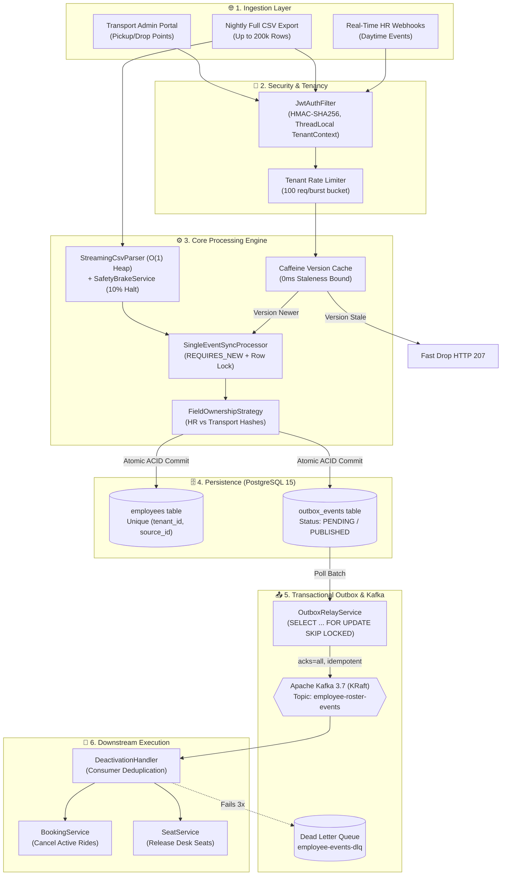
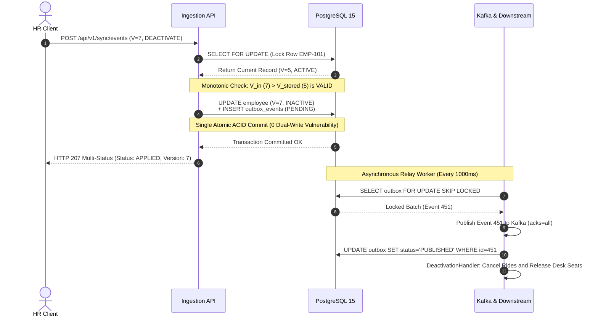

# 🚀 MoveInSync SDE Assessment — System Design Note
## Case Study 5: HR Roster Sync (Idempotent, Out-of-Order, Self-Healing)

[](file:///c:/Users/ashis/OneDrive/Desktop/divyansh/DESIGN_NOTE.md)
[-336791?style=for-the-badge&logo=postgresql&logoColor=white)](file:///c:/Users/ashis/OneDrive/Desktop/divyansh/DESIGN_NOTE.md)
[-231F20?style=for-the-badge&logo=apachekafka&logoColor=white)](file:///c:/Users/ashis/OneDrive/Desktop/divyansh/DESIGN_NOTE.md)
[](file:///c:/Users/ashis/OneDrive/Desktop/divyansh/DESIGN_NOTE.md)

> [!IMPORTANT]
> **Core Engineering Guarantees:**  
> 🟢 **Zero Lost Updates** (Row-level serialization) &nbsp;|&nbsp; 🟢 **Zero Dual-Write Inconsistencies** (Transactional Outbox) &nbsp;|&nbsp; 🟢 **Bounded $O(1)$ Memory** (Streaming CSV engine) &nbsp;|&nbsp; 🟢 **Catastrophic Deactivation Circuit Breaker** (10% safety brake) &nbsp;|&nbsp; 🟢 **Zero PII Exposure** (Deterministic redaction).

---

## 🏛️ 1. System Architecture Diagram

> [!NOTE]
> **Decoupled Resilience:** The synchronous write path only touches PostgreSQL. Downstream event dispatching over Apache Kafka is handled asynchronously via the Transactional Outbox pattern, ensuring HR sync callers are never blocked by broker latency or downtime.



---

## ⚡ 2. Sequence Flow for the Hardest Flow
### *Concurrent Ingestion, Outbox ACID Atomicity, Relay Crash-Recovery & Downstream Deactivation*

> [!TIP]
> **Hardest Engineering Flow Solved:** How the system handles concurrent deactivation updates, guarantees zero dual-write vulnerabilities via the **Transactional Outbox**, and resumes seamlessly after unexpected worker or broker crashes.



### 📋 High-Contrast Execution Trace (Text Alternative)

```text
HR Client               Ingestion API               PostgreSQL 15             Kafka & Downstream
   │                          │                           │                           │
   │── 1. POST /sync/events ─>│                           │                           │
   │   (V=7, DEACTIVATE)      │                           │                           │
   │                          │── 2. SELECT FOR UPDATE ──>│                           │
   │                          │   (Lock Row EMP-101)      │                           │
   │                          │<─ 3. Return Row (V=5) ────│                           │
   │                          │                           │                           │
   │                          │ [Check: V_in > V_stored]  │                           │
   │                          │                           │                           │
   │                          │── 4. UPDATE employee (V=7)─────────┐                  │
   │                          │── 5. INSERT outbox (PENDING)───────┤ (Single Atomic   │
   │                          │<─ 6. Commit Succeeded ─────────────┘  ACID Commit)    │
   │                          │                           │                           │
   │<─ 7. HTTP 207 APPLIED ───│                           │                           │
   │   (Sub-20ms Response)    │                           │                           │
   │                          │                           │                           │
   │                          │               [Async Outbox Relay Worker]             │
   │                          │                           │<── 8. SELECT SKIP LOCKED ─│
   │                          │                           │    (Batch Read Event 451) │
   │                          │                           │                           │
   │                          │                           │── 9. Publish (acks=all) ─>│
   │                          │                           │<── 10. Broker ACK ────────│
   │                          │                           │                           │
   │                          │                           │<── 11. UPDATE PUBLISHED ──│
   │                          │                           │                           │
   │                          │                           │             12. Deactivation Consumer:
   │                          │                           │                 - Deduplicate Event ID
   │                          │                           │                 - Cancel Active Rides
   │                          │                           │                 - Release Desk Seats
```

---

## 🛡️ 3. Failure-Mode & Recovery Table

| # | What Fails? | What the User / Caller Sees | How the System Recovers |
|:---:|:---|:---|:---|
| **1** | **Process crashes between DB commit and Kafka publish** | 🟢 `HTTP 207 APPLIED` | 🛡️ **Transactional Outbox:** The outbox record was committed in the same DB transaction. When the relay restarts, it polls pending rows with `SELECT ... FOR UPDATE SKIP LOCKED` and publishes without event loss. |
| **2** | **Out-of-order webhook delivery** ($V_6$ arrives after $V_7$) | 🟡 `HTTP 207 IGNORED_STALE` | ⏱️ **Monotonic Version Ordering:** Engine checks $V_{\text{incoming}} \le V_{\text{stored}}$. Stale event is rejected immediately without acquiring row locks or triggering downstream cancellations. |
| **3** | **Concurrent updates to the same employee** (10 parallel threads) | 🟢 `HTTP 207 APPLIED` (Winner)<br/>🟡 `HTTP 207 IGNORED_STALE` (Older) | 🔒 **Pessimistic Row Lock:** `SELECT FOR UPDATE` serializes concurrent transactions on the database row. Winner increments version; subsequent threads read new version and exit safely. Zero lost updates. |
| **4** | **Nightly CSV file cut off mid-export** (e.g. 50% missing) | 🔴 `HTTP 422 BLOCKED` *(Missing count alert)* | 🚨 **Safety Brake Circuit Breaker:** Missing ratio ($>10\%$) halts bulk deactivations immediately. 0 employees are deactivated. Requires manual operator approval (`POST .../approve`) to unlock. |
| **5** | **Kafka broker unreachable / network partition** | 🟢 `HTTP 207 APPLIED` *(Uninterrupted Ingestion)* | 📦 **Decoupled Outbox:** Outbox records accumulate safely in PostgreSQL. The relay worker retries with backoff. Once Kafka recovers, the worker drains the queue in strict chronological order. |
| **6** | **Poison pill message on Kafka topic** (malformed JSON) | Downstream ride services log 0 crashes; zero pipeline halt. | 📬 **Dead-Letter Queue (DLQ):** Kafka `DefaultErrorHandler` retries 3 times, then routes poison pill to `employee-events-dlq`. Partition offsets commit cleanly, allowing remaining messages to process. |
| **7** | **HR sync payload contains empty transport fields** | 🟢 `HTTP 207 APPLIED` | 🏷️ **Dual-Hash Field Ownership:** Strategy pattern updates identity fields but preserves `pickup_point`, `drop_point`, and `special_assistance`. HR updates can never erase transport operational data. |
| **8** | **Daytime update arrives after midnight batch generated** | Daytime update is applied; subsequent nightly diff leaves it intact. | 🛡️ **Daytime Stale Shield:** Nightly reconciliation uses file generation timestamp ($V_{\text{file}} = T_{\text{export}}$). Daytime events ($T_{\text{day}} > T_{\text{export}}$) carry higher versions and are protected from overnight regression. |
| **9** | **Rogue client floods API with webhook retry storm** | 🟠 `HTTP 429 Too Many Requests`<br/>*(Header: `Retry-After: 1`)* | 🚦 **Token-Bucket Rate Limiter:** Per-tenant memory-bounded rate limiter throttles burst traffic, protecting database connection pools and CPU resources. |
| **10** | **Malformed phone number or invalid office code** | ⚠️ `HTTP 207 REJECTED`<br/>*(Sanitized error report)* | 🧼 **Boundary Validation & Zero-PII Redaction:** Invalid record is isolated without failing the rest of the batch. `PiiRedactor` scrubs raw phone/email from the error report. |

---

## 📐 4. Core Engineering Invariants & Guarantees

* **1. Monotonic Version Rule:**  
  State mutations occur if and only if $V_{\text{in}} > V_{\text{stored}}$. Older and duplicate versions are strict no-ops.

* **2. Dual-Hash Segregation:**  
  $$\text{HR Hash} = \text{SHA256}(\text{name} + \text{email} + \text{phone} + \text{officeCode} + \text{department} + \text{shift})$$
  $$\text{Transport Hash} = \text{SHA256}(\text{pickupPoint} + \text{dropPoint} + \text{specialAssistance})$$
  *HR sync streams update identity fields but cannot touch transport coordinates. Transport Admin updates commute landmarks but cannot mutate HR identity.*

> [!WARNING]
> **3. Safety Brake Emergency Stop (Catastrophic Deactivation Prevention):**
> $$\text{Missing Ratio} = \frac{|\text{Active in DB}| - |\text{Present in CSV Export}|}{|\text{Active in DB}|} > 0.10 \implies \mathbf{HALT}$$
> Halts execution, flags reconciliation run as `BLOCKED`, and leaves all active employees in place until human operator sign-off.

* **4. Daytime Stale Shield:**  
  The nightly file's creation timestamp is converted to epoch milliseconds ($V_{\text{file}} = T_{\text{export}}$). Real-time events occurring after export have $V > V_{\text{file}}$ and are preserved automatically.

---

## ⏱️ 5. Time & Space Complexity Analysis

| Pipeline Stage | Algorithm / Operation | Time Complexity | Space Complexity |
| :--- | :--- | :---: | :---: |
| **Real-Time Ingestion** | In-memory version cache check | $O(1)$ | $O(1)$ |
| **Real-Time Ingestion** | Pessimistic row lock & update | $O(\log N)$ via B-Tree index | $O(1)$ |
| **Nightly Reconciliation** | DB Active Hash Snapshot (`EmployeeHashView`) | $O(N)$ index scan | **$\approx 24\text{ MB}$ RAM for 200k rows** |
| **Nightly Reconciliation** | Line-by-line CSV streaming diff | $O(M)$ file streaming | **$O(1)$ Constant Heap Memory** |
| **Outbox Relay** | `SELECT ... SKIP LOCKED` batch poll | $O(B)$ ($B = 50$) | $O(B)$ |
| **Downstream Consumer** | Idempotency check & ride cancellation | $O(1)$ | $O(1)$ |

> [!TIP]
> **High-Scale Footprint:** Holding 200,000 active employee hashes in memory requires only **$\approx 24\text{ MB}$ RAM**, scaling comfortably to 5,000,000 employees ($\approx 600\text{ MB}$). At $>50,000\text{ writes/sec}$, Outbox database polling evolves to **Debezium Change Data Capture (CDC)** reading PostgreSQL WAL logs.

---

## ⚖️ 6. Architectural Trade-Off Decisions

* 🎯 **Consistency over Availability (CP over AP):**  
  In fleet logistics, stale pickup points or duplicate active records strand employees or generate duplicate cabs. We choose strict row-level consistency and monotonic ordering over eventual consistency for core employee state.
* 🔒 **Pessimistic Row Locking over Optimistic Locking:**  
  Under concurrent webhook bursts for the same employee, optimistic locking (`@Version`) triggers rollback retry storms. Pessimistic locking (`SELECT FOR UPDATE`) cleanly queues writes at the database row.
* ⚡ **In-Process Caffeine Caching over External Redis:**  
  Eliminates network hops and serialization overhead. Write-through cache updates guarantee **0 ms staleness** on the active write node.
* 🛡️ **Outbox Polling with `SKIP LOCKED` over Distributed Transactions (2PC/XA):**  
  Guarantees atomicity between DB and Kafka without blocking protocols, multi-phase commit overhead, or external coordinators.

---


